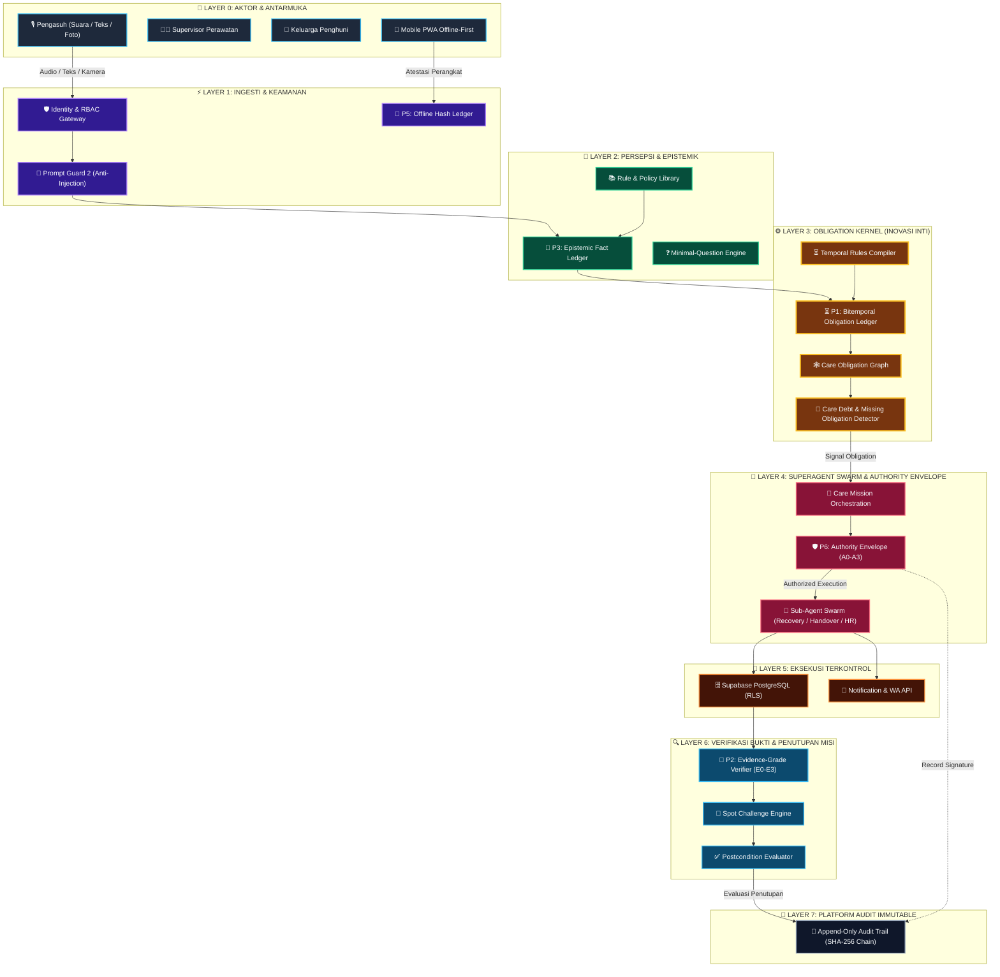

<div align="center">

  <br/>

  <!-- 3D HERO ANIMATION BANNER -->
  <p align="center">
    <a href="https://github.com/s1informatika11s25007-maker/SambungJagaAI">
      
    </a>
  </p>

  # 🛡️ SambungJaga AI — Care Continuity Workspace
  ### *Evidence-Verified Care Continuity Powered by Obligation Kernel & Autonomous Superagent Swarm*

  <p align="center">
    <a href="https://vitejs.dev/"></a>
    <a href="https://react.dev/"></a>
    <a href="https://tailwindcss.com/"></a>
    <a href="https://supabase.com/"></a>
    <a href="https://vitest.dev/"></a>
    <a href="https://playwright.dev/"></a>
  </p>

  <p align="center">
    <b>SambungJaga AI</b> adalah sistem keberlanjutan perawatan (<i>Care Continuity Workspace</i>) untuk panti wreda dan fasilitas lansia. Menggabungkan <b>Obligation Kernel Bitemporal (P1)</b>, <b>Multi-Agent Swarm Orchestration (P6)</b>, dan <b>Verifikasi Bukti Multi-Tingkat (E0–E3)</b> untuk menjamin zero <i>care debt</i> dan akuntabilitas penuh.
  </p>

  <br/>

</div>

---

## ⚡ Pintasan Navigasi (Quick Navigation)

- [🎬 Visualisasi Alur Data 4D Bergerak](#-visualisasi-alur-data-4d-bergerak)
- [🏛️ Detail 10 Layer Pemrosesan Data & 6 Inovasi Kernel](#️-detail-10-layer-pemrosesan-data--6-inovasi-kernel)
- [🌟 Keunggulan Utama & Fitur Sistem](#-keunggulan-utama--fitur-sistem)
- [🤖 Matriks Model AI & Infrastruktur](#-matriks-model-ai--infrastruktur)
- [🚀 Cara Menjalankan & Testing](#-cara-menjalankan--testing)
- [📤 Panduan Push ke GitHub Repository](#-panduan-push-ke-github-repository)

---

## 🎬 Visualisasi Alur Data 4D Bergerak

Setiap laporan perawatan dari pengasuh diproses melalui rantai pemrosesan data 4D yang mengalir dari ingesti suara hingga penyimpanan *audit trail* tak tertempa (*immutable audit trail*).

<!-- ANIMATED 4D DATA FLOW PIPELINE GRAPHIC -->
<p align="center">
  
</p>

### 📐 Diagram Alur Komponen (Mermaid Flowchart)



---

## 🏛️ Detail 10 Layer Pemrosesan Data & 6 Inovasi Kernel

Sistem SambungJaga AI mengorganisasikan aliran data dari hulu ke hilir secara terstruktur melalui **10 Pemrosesan Layer Data** dan **6 Inovasi Kernel Utama (P1–P6)**:

<!-- ANIMATED 3D ISOMETRIC STACK GRAPHIC -->
<p align="center">
  
</p>

<details open>
<summary><b>🔹 Layer 0 — Aktor & Antarmuka Aplikasi</b></summary>
<br/>

- **Input**: Perintah suara (Whisper V3), teks, foto bukti, dan metadata perangkat.
- **Fungsi**: Titik masuk utama seluruh pengguna (Pengasuh, Supervisor, Keluarga, Admin HR) melalui Mobile PWA *Offline-First*.
- **Output**: Payload mentah bertanda atestasi lokal.
</details>

<details open>
<summary><b>⚡ Layer 1 — Akses, Ingesti & Keamanan (P5 Offline Hash Ledger)</b></summary>
<br/>

- **Input**: Payload mentah dari Layer 0.
- **Fungsi**: Memverifikasi identitas pengguna (RBAC), memfilter ancaman *prompt injection* (Meta Llama 22M), dan meminimalkan PII.
- **Inovasi Kernel**: **P5 — Offline Hash-Chain Ledger**. Mengunci stempel waktu lokal (*anti-backdate*) saat internet terputus.
- **Output**: Payload tersterilisasi dengan idempotency key.
</details>

<details open>
<summary><b>🧠 Layer 2 — Persepsi & Pengetahuan (P3 Epistemic Fact Ledger)</b></summary>
<br/>

- **Input**: Teks/suara bebas dari Layer 1.
- **Fungsi**: Mengonversi bahasa sehari-hari pengasuh menjadi fakta medis terstruktur.
- **Inovasi Kernel**: **P3 — Epistemic Fact Ledger**. Membedakan kepastian fakta (*Observed*, *Reported*, *Inferred*, *Contradicted*, *Stale*).
- **Output**: Entri fakta terverifikasi lengkap dengan tingkat kepastian.
</details>

<details open>
<summary><b>⚙️ Layer 3 — Obligation Kernel (P1 Bitemporal Obligation Ledger)</b></summary>
<br/>

- **Input**: Fakta terstruktur dari Layer 2 & Rule Library.
- **Fungsi**: Memetakan kejadian menjadi kewajiban perawatan terstruktur dan mendeteksi keterlambatan.
- **Inovasi Kernel**: **P1 — Bitemporal Obligation Ledger**. Memisahkan *Valid Time* (waktu klinis nyata) & *Transaction Time* (waktu pencatatan database).
- **Output**: Graph kewajiban perawatan & sinyal *care debt*.
</details>

<details open>
<summary><b>🤖 Layer 4 — Superagent Swarm & Authority Envelope (P6 Safeguards)</b></summary>
<br/>

- **Input**: Graph kewajiban dari Layer 3.
- **Fungsi**: Mengorkestrasi agen otonom (Recovery, Handover, HR, Workforce, Family) untuk menangani tugas.
- **Inovasi Kernel**: **P6 — Authority Envelope (A0–A3)**. Menegakkan batasan otorisasi AI (A0 Otomatis s/d A3 Persetujuan Manusia Mutlak).
- **Output**: Kontrak aksi berizin yang terverifikasi aman.
</details>

<details>
<summary><b>💾 Layer 5 — Eksekusi Terkontrol & Penyimpanan Berizin</b></summary>
<br/>

- **Input**: Kontrak aksi dari Layer 4.
- **Fungsi**: Mengeksekusi penulisan database ber-RLS dan mengirim notifikasi WhatsApp/Sistem.
- **Output**: Record tersimpan di Supabase PostgreSQL & notifikasi terkirim.
</details>

<details>
<summary><b>🔍 Layer 6 — Verifikasi Bukti (P2 Evidence-Grade Verifier)</b></summary>
<br/>

- **Input**: Berkas foto bukti & klaim laporan tugas.
- **Fungsi**: Memverifikasi pemenuhan bukti penyelesaian tugas secara obyektif.
- **Inovasi Kernel**: **P2 — Evidence-Grade Verifier (E0–E3)** (E0 Klaim, E1 Foto/QR Hash SHA-256, E2 Dual Signoff Staf, E3 Sensor IoT).
- **Output**: Keputusan penutupan tugas (*Verified Closure* / *Escalation*).
</details>

<details>
<summary><b>🔐 Layer 7 — Platform Audit & Keamanan Immutable</b></summary>
<br/>

- **Input**: Seluruh event & keputusan dari Layer 1–6.
- **Fungsi**: Mencatat jejak aktivitas ke dalam *append-only SHA-256 hash chain*.
- **Output**: Cryptographic audit log tak tertempa.
</details>

<details>
<summary><b>📊 Layer 8 — Analisis & Jaminan Asinkron (P4 Failure Simulator)</b></summary>
<br/>

- **Fungsi**: Simulasi offline risiko kegagalan jadwal & pemutaran ulang aturan (*rule replay*).
- **Inovasi Kernel**: **P4 — Failure-Set Search Simulator**.
- **Output**: Laporan risiko keterlibatan & rekomendasi kapasitas staf.
</details>

<details>
<summary><b>📋 Layer 9 — Keluaran Operasional & Portal Keluarga</b></summary>
<br/>

- **Fungsi**: Menyajikan antarmuka hasil kerja real-time untuk Supervisor & Keluarga (*Consent-Filtered*).
- **Output**: Dashboard Supervisor, Contract Handover Dua Pihak, & Family Portal.
</details>

---

## 🌟 Keunggulan Utama & Fitur Sistem

<table width="100%">
  <tr>
    <td width="50%" valign="top">
      <h3>🎙️ Care Capture & Voice STT</h3>
      <p>Pengasuh dapat menyampaikan laporan perawatan melalui perintah suara (Whisper V3), input teks, atau foto medis. Ekstraksi terstruktur instan di lapangan.</p>
    </td>
    <td width="50%" valign="top">
      <h3>⚙️ Obligation Kernel Bitemporal (P1)</h3>
      <p>Membedakan <i>Valid Time</i> dan <i>Transaction Time</i>. Otomatis mendeteksi <b>Care Debt</b> jika instruksi perawatan medis belum dikerjakan.</p>
    </td>
  </tr>
  <tr>
    <td width="50%" valign="top">
      <h3>🛡️ P6 Authority Envelope (A0–A3)</h3>
      <p>Membatasi wewenang AI. Keputusan klinis dan perubahan dosis obat wajib persetujuan manusia mutlak (A3) dari Supervisor.</p>
    </td>
    <td width="50%" valign="top">
      <h3>🔍 Evidence-Grade Verifier (P2 & P5)</h3>
      <p>Verifikasi bukti multi-tingkat (E0 Klaim verbal, E1 Hash Foto SHA-256, E2 Dual Signoff, E3 Data Sensor) dengan <i>Spot Challenge Engine</i> acak.</p>
    </td>
  </tr>
  <tr>
    <td width="50%" valign="top">
      <h3>📋 Two-Sided Handover Contract</h3>
      <p>Serah terima shift antar pengasuh berikat digital dua arah (Pengirim & Penerima) dengan digest enkripsi SHA-256 terverifikasi di database.</p>
    </td>
    <td width="50%" valign="top">
      <h3>🔗 Immutable SHA-256 Audit Trail</h3>
      <p>Seluruh interaksi, verifikasi bukti, dan keputusan dicatat dalam <i>append-only ledger</i> berantai SHA-256 yang tidak dapat diubah atau dihapus.</p>
    </td>
  </tr>
</table>

---

## 🤖 Matriks Model AI & Infrastruktur

Berdasarkan spesifikasi `modellist.md`, SambungJaga AI ditenagai oleh kombinasi model AI mutakhir:

| Nama Model | Provider | Model ID | Fungsi Utama dalam Sistem | Batas Rate & Kuota |
| :--- | :--- | :--- | :--- | :--- |
| **Qwen 3.8 27B** | Alibaba Cloud | `qwen/qwen3.8-27b` | Ekstraksi Persepsi & Reasoning Konteks Lansia | 30 req/min • 200K tok/day |
| **Llama Prompt Guard 2** | Meta | `meta-llama/llama-prompt-guard-2-22m` | Filter Keamanan & Ingesti Teks Bebas Injection | 30 req/min • 500K tok/day |
| **GPT OSS 120B** | OpenAI | `openai/gpt-oss-120b` | Superagent Orchestration & Synthesizer Handover | 30 req/min • 200K tok/day |
| **Safety GPT OSS 20B** | OpenAI | `openai/gpt-oss-safeguard-20b` | Validasi Policy Gate & Enforce Envelope A0–A3 | 3 req/min • 200K tok/day |
| **Whisper Large V3 / Turbo** | OpenAI | `whisper-large-v3-turbo` | Speech-to-Text Laporan Suara Pengasuh Realtime | 20 req/min • 2K req/day |

---

## 🚀 Cara Menjalankan & Testing

### 📋 Prasyarat
- **Node.js**: Versi 20.x LTS atau lebih baru
- **npm**: Versi 10.x+
- **Supabase CLI**: Untuk pengaplikasian migration database

### 1️⃣ Clone Repository & Instal Dependensi

```bash
git clone https://github.com/s1informatika11s25007-maker/SambungJagaAI.git
cd SambungJagaAI
npm ci
```

### 2️⃣ Konfigurasi `.env.local`

Salin `.env.example` ke `.env.local` dan isi kredensial Supabase Anda:

```bash
cp .env.example .env.local
```

### 3️⃣ Setup Migration Database Supabase

```bash
npx supabase link --project-ref YOUR_PROJECT_REF
npx supabase db push
```

### 4️⃣ Jalankan Mode Development Server & Testing Suite

```bash
# Jalankan Server Frontend Vite
npm run dev

# Eksekusi Unit Test (Vitest)
npm run test:unit

# Eksekusi End-to-End Test (Playwright)
npm run test:e2e
```

---

## 📤 Panduan Push ke GitHub Repository

Gunakan kredensial `GH_TOKEN` dari berkas `.env` untuk melakukan push perubahan secara langsung:

```bash
# 1. Cek status repositori lokal
git status

# 2. Tambahkan berkas yang diperbarui
git add .

# 3. Buat commit terstruktur
git commit -m "docs: streamline README.md layout & add 4D data flow animation"

# 4. Push ke repositori GitHub menggunakan token dari .env
git push https://<YOUR_GITHUB_TOKEN>@github.com/s1informatika11s25007-maker/SambungJagaAI.git main
```

---

## 🔒 Kebijakan Keamanan & Batasan Klinis

1. **Bukan Alat Diagnosis Mandiri**: SambungJaga AI adalah sistem otomasi koordinasi tugas. Keputusan medis, terapi, dan diagnosis tetap menjadi wewenang penuh dokter/supervisor berwenang.
2. **Perlindungan Privasi PDP/PHI**: Portal keluarga dilindungi oleh *Consent Disclosure Filter* yang membatasi informasi sesuai izin lansia/fasilitas.
3. **Integritas Bukti SHA-256**: Hash foto digunakan untuk mendeteksi manipulasi artefak lokal secara matematis.

---

<div align="center">
  <sub>Dikembangkan dengan ❤️ untuk Keberlanjutan Perawatan Lansia & Kesehatan Terpadu Indonesia</sub><br/>
  <b>© 2026 SambungJaga AI Team. All Rights Reserved.</b>
</div>
