<div align="center">

  <br/>

  <!-- 3D HERO ANIMATION BANNER -->
  <p align="center">
    <a href="https://github.com/s1informatika11s25007-maker/SambungJagaAI">
      
    </a>
  </p>

  # 🛡️ SambungJaga AI — Care Continuity Workspace
  ### *Ruang Kerja Terpadu Perawatan Lansia Bebas Tugas Terlewat*

  <p align="center">
    <a href="https://vitejs.dev/"></a>
    <a href="https://react.dev/"></a>
    <a href="https://tailwindcss.com/"></a>
    <a href="https://supabase.com/"></a>
    <a href="https://vitest.dev/"></a>
    <a href="https://playwright.dev/"></a>
  </p>

  <p align="center">
    <b>SambungJaga AI</b> adalah platform digital yang membantu panti wreda dan fasilitas lansia menghubungkan <b>laporan harian</b>, <b>tugas jadwal perawatan</b>, <b>bukti foto penyelesaian</b>, dan <b>serah terima pergantian shift</b> secara rapi, otomatis, dan terpercaya.
  </p>

  <br/>

</div>

---

## ⚡ Pintasan Navigasi

- [💡 Apa itu SambungJaga AI?](#-apa-itu-sambungjaga-ai)
- [🤖 Cara Kerja Sederhana (4 Langkah)](#-cara-kerja-sederhana-4-langkah)
- [👥 Fitur Utama Berdasarkan Peran](#-fitur-utama-berdasarkan-peran)
- [🏛️ Spesifikasi Teknis 10 Layer (Untuk Pengembang)](#️-spesifikasi-teknis-10-layer-untuk-pengembang)
- [🤖 Matriks Model AI](#-matriks-model-ai)
- [🚀 Cara Menjalankan Aplikasi](#-cara-menjalankan-aplikasi)

---

## 💡 Apa itu SambungJaga AI?

Di fasilitas perawatan lansia, informasi harian mudah tercecer ketika petugas berganti shift. **SambungJaga AI** hadir sebagai asisten pintar pendamping yang memastikan seluruh kebutuhan perawatan lansia (seperti pemberian obat, ukur tekanan darah, makan, dan mandikan) tersusun rapi tanpa ada tugas yang terlewat atau terlupakan (*zero care debt*).

---

## 🤖 Cara Kerja Sederhana (4 Langkah)

Asisten robot AI SambungJaga mendampingi tim perawatan melalui 4 langkah mudah:

<!-- ANIMATED ROBOT ASSISTANT WORKFLOW GRAPHIC -->
<p align="center">
  
</p>

1. **🎙️ Tangkap Laporan**: Pengasuh cukup berbicara lewat suara (*voice note*), mengetik pesan, atau mengambil foto. AI akan membaca laporan tersebut secara otomatis.
2. **📋 Susun Tugas**: Sistem mengubah laporan menjadi jadwal tugas yang terorganisir lengkap dengan tingkat prioritas lansia.
3. **📷 Verifikasi Bukti**: Tugas yang selesai dilengkapi foto bukti atau konfirmasi QR lokasi sehingga kualitas perawatan terjamin.
4. **🤝 Serah Terima Shift**: Pengasuh shift berikutnya langsung mendapatkan ringkasan operan tugas tanpa takut ada informasi yang hilang.

---

## 👥 Fitur Utama Berdasarkan Peran

| Peran Pengguna | Kemampuan & Manfaat Utama |
| :--- | :--- |
| **👩‍⚕️ Pengasuh (Caregiver)** | PWA *Offline-First* dapat digunakan tanpa internet, perekaman suara harian (*Whisper STT*), dan pengunggahan foto bukti tugas. |
| **👨‍⚕️ Supervisor Perawatan** | Dashboard pemantauan real-time, penugasan ulang otomatis saat staf berhalangan, dan persetujuan tindakan khusus (*Human-in-the-Loop*). |
| **🏡 Keluarga Lansia** | Portal Keluarga aman yang menyajikan ringkasan perkembangan kesehatan harian lansia sesuai izin fasilitas (*Consent Filtered*). |
| **🏢 Admin HR & Fasilitas** | Laporan operasional bulanan, pelacakan jadwal shift, dan pemantauan sertifikasi kompetensi staf. |

---

## 🏛️ Spesifikasi Teknis 10 Layer (Untuk Pengembang)

Bagi pengembang yang ingin memahami arsitektur internal, SambungJaga AI membagi pemrosesan data ke dalam **10 Layer Teknis** berbasis **Obligation Kernel (P1–P6)**:

<!-- ANIMATED 3D ISOMETRIC STACK GRAPHIC -->
<p align="center">
  
</p>

<details>
<summary><b>🔍 Klik untuk melihat rincian teknis Layer 0 s/d Layer 9</b></summary>
<br/>

- **Layer 0 (Aktor & Ingesti)**: UI React 18, Mobile PWA Offline-First, dan tangkapan audio/foto.
- **Layer 1 (Keamanan & Injection Filter)**: Identity RBAC, Prompt Guard 2 (Meta Llama 22M), dan P5 Offline Hash Ledger (*anti-backdate*).
- **Layer 2 (Persepsi & Epistemik)**: P3 Epistemic Fact Ledger yang mengkategorikan kepastian fakta (*Observed/Reported/Inferred*).
- **Layer 3 (Obligation Kernel)**: P1 Bitemporal Obligation Ledger memisahkan *Valid Time* (waktu medis) dan *Transaction Time* (waktu database).
- **Layer 4 (Superagent Swarm)**: Care Mission Orchestrator & P6 Authority Envelope (enforce wewenang A0 s/d A3).
- **Layer 5 (Eksekusi Terkontrol)**: Supabase PostgreSQL RLS, Signed Storage, dan Notifikasi WhatsApp.
- **Layer 6 (Verifikasi Bukti)**: P2 Evidence-Grade Verifier (pemeriksaan bukti E0 Klaim, E1 Foto SHA-256 Hash, E2 Dual Signoff, E3 Sensor).
- **Layer 7 (Platform Audit)**: Append-Only SHA-256 Hash-Chained Audit Trail tak tertempa.
- **Layer 8 (Analisis Asinkron)**: P4 Failure-Set Search Simulator untuk deteksi potensi risiko jadwal.
- **Layer 9 (Keluaran & Handover)**: Two-Sided Handover Contract, Supervisor Dashboard, dan Family Portal.

</details>

---

## 🤖 Matriks Model AI

Sistem mengintegrasikan model AI sesuai spesifikasi `modellist.md`:

| Nama Model | Provider | ID Model | Fungsi Utama |
| :--- | :--- | :--- | :--- |
| **Qwen 3.8 27B** | Alibaba Cloud | `qwen/qwen3.8-27b` | Reasoning & Ekstraksi Konteks Perawatan Lansia |
| **Llama Prompt Guard 2** | Meta | `meta-llama/llama-prompt-guard-2-22m` | Filter Keamanan & Proteksi Prompt Injection |
| **GPT OSS 120B** | OpenAI | `openai/gpt-oss-120b` | Superagent Swarm Orchestration & Ringkasan Shift |
| **Safety GPT OSS 20B** | OpenAI | `openai/gpt-oss-safeguard-20b` | Validasi Otorisasi A0–A3 & Policy Gate |
| **Whisper Large V3** | OpenAI | `whisper-large-v3-turbo` | Speech-to-Text Laporan Suara Pengasuh Realtime |

---

## 🚀 Cara Menjalankan Aplikasi

### 📋 Prasyarat
- **Node.js**: Versi 20.x LTS atau lebih baru
- **npm**: Versi 10.x+
- **Supabase CLI**: Untuk pengaplikasian migration database

### 1️⃣ Clone & Instal Dependensi

```bash
git clone https://github.com/s1informatika11s25007-maker/SambungJagaAI.git
cd SambungJagaAI
npm ci
```

### 2️⃣ Konfigurasi Variabel Lingkungan (`.env.local`)

Salin `.env.example` ke `.env.local` dan atur variabel Supabase Anda:

```bash
cp .env.example .env.local
```

### 3️⃣ Jalankan Database & Mode Development

```bash
# Push migration database Supabase
npx supabase db push

# Jalankan server aplikasi lokal
npm run dev
```

Akses aplikasi di peramban: `http://localhost:5173`.

### 4️⃣ Jalankan Testing Suite

```bash
# Unit Tests (Vitest)
npm run test:unit

# End-to-End Tests (Playwright)
npm run test:e2e
```

---

## 🔒 Kebijakan Keamanan & Batasan Klinis

1. **Pendamping Administratif**: SambungJaga AI bertindak sebagai alat koordinasi dan penyusun jadwal. Keputusan medis, diagnosis, dan dosis obat tetap menjadi wewenang mutlak tenaga kesehatan berwenang.
2. **Perlindungan Privasi Data**: Informasi pada Portal Keluarga disaring secara otomatis sesuai tingkat izin (*Consent Disclosure Filter*).
3. **Integritas Bukti SHA-256**: Hash foto digunakan untuk memastikan foto bukti tidak diubah dari perangkat lokal.

---

<div align="center">
  <sub>Dikembangkan dengan ❤️ untuk Keberlanjutan Perawatan Lansia & Kesehatan Terpadu Indonesia</sub><br/>
  <b>© 2026 SambungJaga AI Team. All Rights Reserved.</b>
</div>
