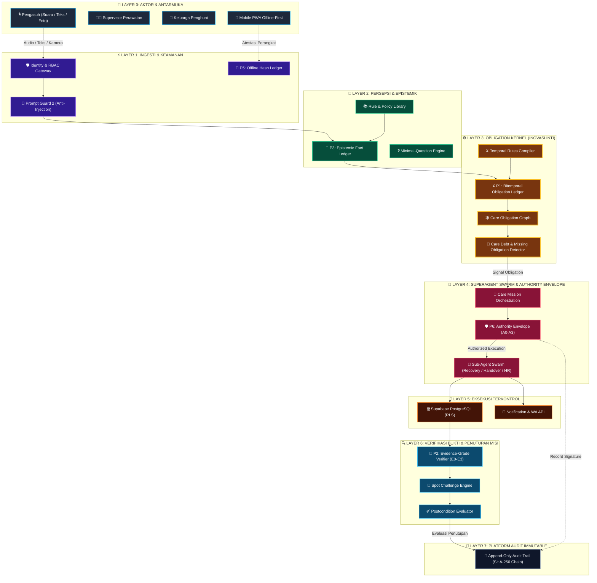

<div align="center">

  <br/>

  <!-- 3D MOVING ANIMATION BANNER -->
  <p align="center">
    <a href="https://github.com/s1informatika11s25007-maker/SambungJagaAI">
      
    </a>
  </p>

  # 🛡️ SambungJaga AI — Care Continuity Workspace
  ### *Evidence-Verified Care Continuity Powered by Obligation Kernel & Autonomous Superagent Swarm*

  <p align="center">
    <a href="https://vitejs.dev/"></a>
    <a href="https://react.dev/"></a>
    <a href="https://tailwindcss.com/"></a>
    <a href="https://supabase.com/"></a>
    <a href="https://vitest.dev/"></a>
    <a href="https://playwright.dev/"></a>
  </p>

  <p align="center">
    <b>SambungJaga AI</b> adalah sistem manajemen keberlanjutan perawatan (<i>Care Continuity Workspace</i>) generasi baru untuk panti wreda dan fasilitas perawatan berjangka panjang. Menggabungkan <b>Obligation Kernel Bitemporal</b>, <b>Multi-Agent Swarm Orchestration</b>, dan <b>Verifikasi Bukti Multi-Tingkat (E0–E3)</b> untuk memastikan tidak ada tugas perawatan pasien yang terlewat, dipalsukan, atau mengalami <i>care debt</i>.
  </p>

  <br/>

</div>

---

## ⚡ Pintasan Navigasi (Quick Navigation)

- [🎨 Visualisasi Arsitektur & Diagram Data](#-visualisasi-arsitektur--diagram-data)
- [🏛️ Detail 10 Layer Pemrosesan Data & 6 Inovasi Kernel](#️-detail-10-layer-pemrosesan-data--6-inovasi-kernel)
- [🌟 Fitur-Fitur Interaktif & Utama](#-fitur-fitur-interaktif--utama)
- [🤖 Matriks Model AI & Infrastruktur](#-matriks-model-ai--infrastruktur)
- [🚀 Cara Menjalankan & Deployment](#-cara-menjalankan--deployment)
- [📤 Panduan Push ke GitHub Repository](#-panduan-push-ke-github-repository)

---

## 🎨 Visualisasi Arsitektur & Diagram Data

Sistem SambungJaga AI beroperasi melalui jaringan pemrosesan data berlapis yang menghubungkan laporan pengasuh di lapangan hingga audit transaksional tak tertempa (*immutable audit trail*).



---

## 🏛️ Detail 10 Layer Pemrosesan Data & 6 Inovasi Kernel

Sistem SambungJaga AI dirancang secara holistik melalui **10 Pemrosesan Layer Data** dan **6 Inovasi Kernel Utama (P1–P6)**:

<!-- ANIMATED 3D ISOMETRIC STACK GRAPHIC -->
<p align="center">
  
</p>

<details open>
<summary><b>🔹 Layer 0 — Aktor & Antarmuka Aplikasi</b></summary>
<br/>

- **Fungsi**: Titik masuk utama seluruh aktor di fasilitas perawatan (Pengasuh, Supervisor, Keluarga, Admin HR).
- **Komponen**: Application UI (React 18), Mobile PWA dengan *Offline-First Capabilities*, Voice Speech Input (Whisper V3), dan Kamera Bukti.
- **Keluaran**: Payload mentah (audio, teks, foto) dan metadata perangkat.
</details>

<details open>
<summary><b>⚡ Layer 1 — Akses, Ingesti & Keamanan (P5 Offline Hash Ledger)</b></summary>
<br/>

- **Fungsi**: Memverifikasi identitas pengguna (RBAC), memfilter ancaman *prompt injection*, dan menjaga integritas waktu saat perangkat offline.
- **Inovasi Kernel**: **P5 — Offline Hash-Chain Ledger**. Menggunakan atestasi perangkat lokal untuk mencatat urutan kejadian (*anti-backdate*) ketika koneksi internet terputus.
- **Komponen**: *Identity Gateway*, *Prompt Guard 2 (Meta Llama 22M)*, *PII Minimization Engine*, dan *Durable Queue* dengan idempotency key.
</details>

<details open>
<summary><b>🧠 Layer 2 — Persepsi & Pengetahuan (P3 Epistemic Fact Ledger)</b></summary>
<br/>

- **Fungsi**: Mengubah teks/suara informal dari pengasuh menjadi fakta terstruktur yang valid.
- **Inovasi Kernel**: **P3 — Epistemic Fact Ledger**. Membedakan fakta berdasarkan derajat kepastian: *Observed* (Diamati), *Reported* (Dilaporkan), *Inferred* (Disimpulkan), *Contradicted* (Dikontradiksi), dan *Stale* (Basi).
- **Komponen**: *Rule & Policy Library* ber-versi, *Resident Context & Provenance Engine*, serta *Minimal-Question Clarification Engine*.
</details>

<details open>
<summary><b>⚙️ Layer 3 — Obligation Kernel (P1 Bitemporal Obligation Ledger)</b></summary>
<br/>

- **Fungsi**: Jantung logika sistem untuk mengelola seluruh kewajiban perawatan lansia.
- **Inovasi Kernel**: **P1 — Bitemporal Obligation Ledger**. Memisahkan *Valid Time* (kapan tindakan harus terjadi secara medis) dan *Transaction Time* (kapan data dicatat di database).
- **Komponen**: *Temporal Rules Compiler*, *Care Obligation Graph*, *Negative-Obligation Checker*, dan *Care Debt & Missing Obligation Detector*.
</details>

<details open>
<summary><b>🤖 Layer 4 — Superagent Swarm & Authority Envelope (P6 Safeguards)</b></summary>
<br/>

- **Fungsi**: Mengoordinasikan sekumpulan agen otonom untuk menyelesaikan misi perawatan tanpa konflik.
- **Inovasi Kernel**: **P6 — Authority Envelope (A0–A3)**. Menjaga batasan kedaulatan AI:
  - **A0**: Tindakan administratif otomatis.
  - **A1**: Pembacaan & pembaruan status sistem internal.
  - **A2**: Notifikasi & eskalasi penting.
  - **A3**: Keputusan klinis/medis yang **wajib persetujuan manusia mutlak**.
- **Komponen**: *Care Mission Orchestrator*, *Sub-Agent Swarm* (Recovery, Handover, HR, Workforce, Family Liaison), dan *Tool Execution Registry*.
</details>

<details>
<summary><b>💾 Layer 5 — Eksekusi Terkontrol & Penyimpanan Berizin</b></summary>
<br/>

- **Fungsi**: Mengeksekusi tindakan terotorisasi ke database dan kanal komunikasi.
- **Komponen**: Supabase PostgreSQL dengan *Row-Level Security (RLS)* ketat, *Signed Storage* untuk foto medis berprivasi, *Notification Engine*, dan *WhatsApp API Gateway*.
</details>

<details>
<summary><b>🔍 Layer 6 — Verifikasi Bukti (P2 Evidence-Grade Verifier)</b></summary>
<br/>

- **Fungsi**: Memastikan setiap kewajiban yang dilaporkan selesai dengan bukti otentik.
- **Inovasi Kernel**: **P2 — Evidence-Grade Verifier (E0–E3)**:
  - **E0**: Klaim verbal/teks sederhana.
  - **E1**: Artefak foto ber-hash SHA-256 / QR lokasi.
  - **E2**: Konfirmasi tanda tangan dari staf kedua.
  - **E3**: Verifikasi sensor IoT / perangkat medis terhubung.
- **Komponen**: *Spot Challenge Engine* (pemeriksaan sampel acak) & *Postcondition Evaluator*.
</details>

<details>
<summary><b>🔐 Layer 7 — Platform Audit & Keamanan Immutable</b></summary>
<br/>

- **Fungsi**: Menjamin akuntabilitas dan transparansi hukum penuh.
- **Komponen**: *Append-Only Hash-Chained Audit Trail (SHA-256 Chain)*. Mencatat seluruh ingesti, keputusan agen, verifikasi bukti, dan override manusia secara tak tertempa.
</details>

<details>
<summary><b>📊 Layer 8 — Analisis & Jaminan Asinkron (P4 Failure Simulator)</b></summary>
<br/>

- **Fungsi**: Evaluasi risiko sistem secara offline dan pemutaran ulang aturan (*rule replay*).
- **Inovasi Kernel**: **P4 — Failure-Set Search Simulator**. Mensimulasikan kombinasi kegagalan staf tercepat untuk mencegah *care debt* sebelum terjadi.
- **Komponen**: *Competency Gap Report*, *Retroactive Rule Replay*, dan *Adversarial Agent Benchmark Lab*.
</details>

<details>
<summary><b>📋 Layer 9 — Keluaran Operasional & Portal Keluarga</b></summary>
<br/>

- **Fungsi**: Menyajikan antarmuka hasil kerja dan serah terima shift secara real-time.
- **Komponen**: *Two-Sided Handover Contract*, *Realtime Supervisor Dashboard*, *Consent-Filtered Family Portal*, dan *Care Evidence Pack (.json audit export)*.
</details>

---

## 🌟 Fitur-Fitur Interaktif & Utama

<table width="100%">
  <tr>
    <td width="50%" valign="top">
      <h3>🎙️ Care Capture & Voice STT</h3>
      <p>Pengasuh dapat menyampaikan laporan perawatan melalui perintah suara (Whisper V3), input teks, atau foto medis. Sistem mengekstraksi instruksi terstruktur secara otomatis tanpa mengganggu alur kerja pengasuh di lapangan.</p>
    </td>
    <td width="50%" valign="top">
      <h3>⚙️ Obligation Kernel Bitemporal (P1)</h3>
      <p>Membedakan <i>Valid Time</i> (kapan tindakan perawatan harus dilakukan di dunia nyata) dan <i>Transaction Time</i> (kapan data dicatat di database). Otomatis mendeteksi <b>Care Debt</b> jika ada instruksi perawatan yang tertunda.</p>
    </td>
  </tr>
  <tr>
    <td width="50%" valign="top">
      <h3>🛡️ P6 Authority Envelope & Safeguards</h3>
      <p>Membatasi wewenang AI dari tingkat <b>A0 (Otomatis)</b> hingga <b>A3 (Kedaulatan Manusia Mutlak)</b>. AI tidak pernah membuat keputusan klinis atau mengubah resep obat tanpa persetujuan verbal/tertulis dari Supervisor berwenang.</p>
    </td>
    <td width="50%" valign="top">
      <h3>🔍 Evidence-Grade Verifier (P2 & P5)</h3>
      <p>Memvalidasi bukti penyelesaian tugas melalui 4 tingkatan (E0 Klaim, E1 Foto/QR Hash, E2 Verifikasi Staf Kedua, E3 Data Sensor IoT). Dilengkapi <i>Spot Challenge Engine</i> acak untuk pengujian kualitas.</p>
    </td>
  </tr>
  <tr>
    <td width="50%" valign="top">
      <h3>📋 Two-Sided Handover Contract</h3>
      <p>Serah terima shift antar pengasuh yang mengikat secara digital dengan dua konfirmasi pihak (Pengirim & Penerima) serta digest enkripsi SHA-256 yang tersimpan dalam database.</p>
    </td>
    <td width="50%" valign="top">
      <h3>🔗 Immutable SHA-256 Audit Trail</h3>
      <p>Setiap interaksi, persetujuan supervisor, eksekusi tool, dan pengunggahan bukti dicatat dalam <i>append-only ledger</i> berantai SHA-256 yang tidak dapat diubah atau dihapus.</p>
    </td>
  </tr>
</table>

---

## 🤖 Matriks Model AI & Infrastruktur

Berdasarkan spesifikasi `modellist.md`, ekosistem SambungJaga AI ditenagai oleh kombinasi model AI mutakhir:

| Nama Model | Provider | Model ID | Fungsi Utama dalam Sistem | Batas Rate & Kuota |
| :--- | :--- | :--- | :--- | :--- |
| **Qwen 3.8 27B** | Alibaba Cloud | `qwen/qwen3.8-27b` | Ekstraksi Persepsi & Reasoning Konteks Lansia | 30 req/min • 200K tok/day |
| **Llama Prompt Guard 2** | Meta | `meta-llama/llama-prompt-guard-2-22m` | Filter Keamanan & Ingesti Teks Bebas Injection | 30 req/min • 500K tok/day |
| **GPT OSS 120B** | OpenAI | `openai/gpt-oss-120b` | Superagent Orchestration & Synthesizer Handover | 30 req/min • 200K tok/day |
| **Safety GPT OSS 20B** | OpenAI | `openai/gpt-oss-safeguard-20b` | Validasi Policy Gate & Enforce Envelope A0–A3 | 3 req/min • 200K tok/day |
| **Whisper Large V3 / Turbo** | OpenAI | `whisper-large-v3-turbo` | Speech-to-Text Laporan Suara Pengasuh Realtime | 20 req/min • 2K req/day |

---

## 🚀 Cara Menjalankan & Deployment

### 📋 Prasyarat
- **Node.js**: Versi 20.x LTS atau lebih baru
- **npm**: Versi 10.x+
- **Supabase CLI**: Untuk verifikasi & pengaplikasian migration database

### 1️⃣ Clone Repository & Instal Dependensi

```bash
git clone https://github.com/s1informatika11s25007-maker/SambungJagaAI.git
cd SambungJagaAI
npm ci
```

### 2️⃣ Konfigurasi `.env.local`

Buat berkas `.env.local` dari `.env.example`:

```bash
cp .env.example .env.local
```

Pastikan variabel Supabase terisi:

```env
VITE_SUPABASE_URL=https://your-supabase-project.supabase.co
VITE_SUPABASE_ANON_KEY=your-supabase-anon-key
```

### 3️⃣ Setup Migration Database Supabase

Terapkan migration skema database ke Supabase:

```bash
npx supabase link --project-ref YOUR_PROJECT_REF
npx supabase db push
```

### 4️⃣ Jalankan Mode Pengembang (Development Server)

```bash
npm run dev
```

Akses aplikasi melalui peramban pada `http://localhost:5173`.

---

## 🧪 Eksekusi Pengujian (Testing Suite)

Proyek ini telah dilengkapi dengan unit test & E2E test yang dapat diuji dengan mudah:

```bash
# Pengujian Unit (Vitest)
npm run test:unit

# Pengujian End-to-End (Playwright)
npm run test:e2e

# Jalankan Seluruh Test Suite
npm run test
```

---

## 📤 Panduan Push ke GitHub Repository

Gunakan kredensial `GH_TOKEN` dari berkas `.env` untuk melakukan push perubahan secara langsung:

```bash
# 1. Cek status repositori lokal
git status

# 2. Tambahkan berkas yang diperbarui
git add .

# 3. Buat commit terstruktur
git commit -m "docs: add 3D moving SVG animations & update README.md"

# 4. Push ke repositori GitHub menggunakan token dari .env
git push https://<YOUR_GITHUB_TOKEN>@github.com/s1informatika11s25007-maker/SambungJagaAI.git main
```

---

## 🔒 Kebijakan Keamanan & Batasan Klinis

1. **Otomasi Administratif & Pendukung**: SambungJaga AI tidak memberikan instruksi medis, mengubah terapi obat, atau memberikan diagnosis mandiri. Keputusan klinis tetap sepenuhnya di bawah wewenang dokter/staf kesehatan berwenang.
2. **Perperlindungan Data PHI/PII**: Semua data yang dibagikan ke Portal Keluarga diproses melalui penyaringan privasi (*Consent Disclosure Engine*).
3. **Integritas SHA-256**: Hash berkas foto digunakan untuk mendeteksi manipulasi artefak lokal, bukan pengganti tanda tangan digital tersertifikasi medis.

---

<div align="center">
  <sub>Dikembangkan dengan ❤️ untuk Keberlanjutan Perawatan Lansia & Kesehatan Terpadu Indonesia</sub><br/>
  <b>© 2026 SambungJaga AI Team. All Rights Reserved.</b>
</div>
